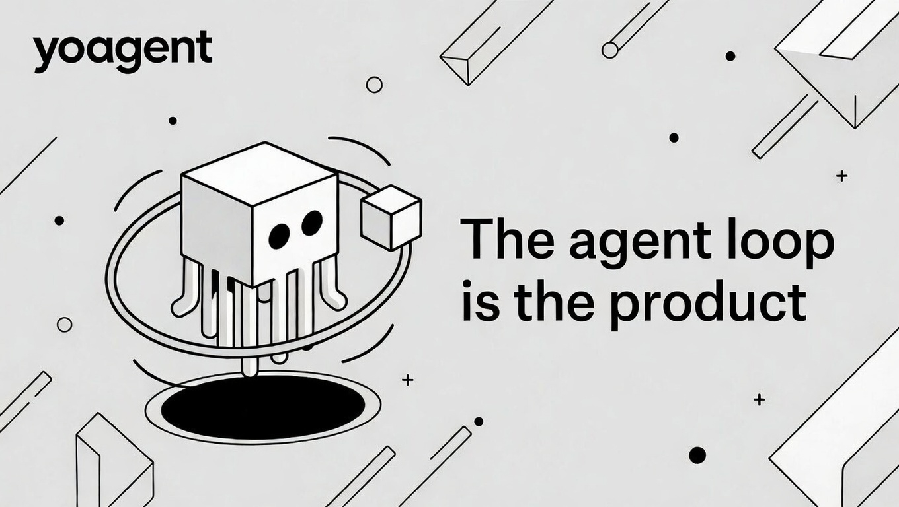
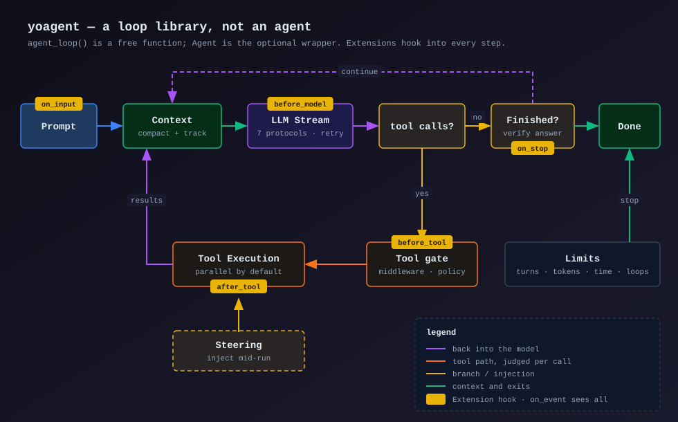

<div align="center">

<picture>
  
</picture>

<a href="#快速开始">快速开始</a> · <a href="https://yologdev.github.io/yoagent/design-philosophy.zh-CN.html">设计哲学</a> · <a href="https://yologdev.github.io/yoagent/">文档</a> · <a href="https://docs.rs/yoagent">API</a> · <a href="CHANGELOG.md">更新日志</a> · <a href="README.md">English</a>

[![][crates-shield]][crates-link]
[![][docsrs-shield]][docsrs-link]
[![][ci-shield]][ci-link]
[![][msrv-shield]][msrv-link]
[![][license-shield]][license-link]
[![][deepwiki-shield]][deepwiki-link]

**Rust 的 agent 循环。** 从 7 种 LLM 协议中任选其一流式输出，执行工具，循环直到完成。

[是循环库，不是 agent](https://yologdev.github.io/yoagent/design-philosophy.zh-CN.html)：它驱动着 [yoyo](https://github.com/yologdev/yoyo-evolve)——一个自 2026 年 3 月起不断演化自身源码的编程 agent。它可以从笔记本电脑一直跑到 Cloudflare Worker。

</div>

<picture>
  <source media="(prefers-color-scheme: dark)" srcset="docs/images/loop.svg">
  <source media="(prefers-color-scheme: light)" srcset="docs/images/loop-light.svg">
  
</picture>

---

## 一条命令试用——无需 API 密钥

```bash
git clone https://github.com/yologdev/yoagent && cd yoagent
ollama serve &
ollama pull llama3.1:8b                           # 或传入 --model <任意已拉取的模型>
cargo run --example cli -- --provider ollama
```

这就是终端里一个能用的编程 agent——文件读写和编辑、shell、ripgrep 搜索、流式输出、skills。不用注册，不用密钥，什么都不用配置。

```
  yoagent cli — mini coding agent
  Type /quit to exit, /clear to reset

  model: llama3.1:8b
  cwd:   /home/user/my-project

> find all TODO comments in src/

  ▶ search 'TODO' ✓

Found 3 TODOs:
  src/main.rs:42: // TODO: handle edge case
  src/lib.rs:15:  // TODO: add tests
  src/utils.rs:8: // TODO: optimize this

  tokens: 1250 in / 89 out
```

换一个参数就能改用托管模型：

```bash
ANTHROPIC_API_KEY=sk-... cargo run --example cli
GROQ_API_KEY=...        cargo run --example cli -- --provider groq --model openai/gpt-oss-120b
cargo run --example cli -- --api-url http://localhost:1234/v1 --model my-model   # LM Studio、llama.cpp、vLLM
```

---

## 安装

```toml
[dependencies]
yoagent = "0.26"
tokio = { version = "1", features = ["full"] }
```

要构建 wasm32？使用 `default-features = false`（见
[WebAssembly 与 Cloudflare Workers](https://yologdev.github.io/yoagent/guides/wasm-workers.html)）。
在原生目标上请保留默认的 `native` feature：没有它，reqwest 就没有 TLS，所有 HTTPS 提供商调用都会在运行时失败。

## 快速开始

一个真正会用工具的 agent——这个 crate 正是为此而生：

```rust
use yoagent::provider::ModelConfig;
use yoagent::{tools, Agent, AgentEvent, StreamDelta};

#[tokio::main]
async fn main() {
    // 提供商由配置中的协议选定，密钥从 ANTHROPIC_API_KEY 读取。
    // 也可以调用 `.with_api_key(k)` 显式传入。
    let mut agent = Agent::from_config(ModelConfig::claude_sonnet_5())
        .with_system_prompt("You are a coding assistant.")
        .with_tools(tools::default_tools());

    let mut events = agent.prompt("Find every TODO in src/ and summarise them").await;

    while let Some(event) = events.recv().await {
        match event {
            AgentEvent::MessageUpdate { delta: StreamDelta::Text { delta }, .. } => print!("{delta}"),
            AgentEvent::ToolExecutionStart { tool_name, .. } => println!("\n▶ {tool_name}"),
            AgentEvent::AgentEnd { .. } => break,
            _ => {}
        }
    }
    agent.finish().await;
}
```

换模型就是换配置——提供商随之切换，密钥从该提供商约定的环境变量读取：

```rust
Agent::from_config(ModelConfig::groq("openai/gpt-oss-120b", "GPT-OSS 120B"));    // GROQ_API_KEY
Agent::from_config(ModelConfig::gemini_3_8_flash());                              // GEMINI_API_KEY
Agent::from_config(ModelConfig::ollama("http://localhost:11434/v1", "llama3.1:8b")); // 无需密钥
```

---

## 为什么是 yoagent

每个 agent 跑的都是同一个循环，而几乎每个手写的循环都在同样的地方出错：流结束得不好，工具 panic 或卡死，上下文用完，运行停不下来，花费没人算得清。yoagent 把这个循环写一次，每项保证都有测试钉住，并用一条规则决定什么能放进来：**是不是每个 agent 都需要它，而且需要的方式相同？** 其余的都是扩展、feature 或配套 crate（[设计哲学](https://yologdev.github.io/yoagent/design-philosophy.zh-CN.html)）。

所以它**不**附带向量库、embedding 流水线或任务图层——如果你的问题是检索或编排，下面这些更合适：

| 如果你需要 | 看看 |
|---|---|
| RAG 流水线、向量库、embedding、转录和图像生成 | [`rig`](https://github.com/0xPlaygrounds/rig)——*"Build modular and scalable LLM Applications in Rust"* |
| 与 agent 并行的类型化任务图和流式 RAG 索引 | [`swiftide`](https://github.com/bosun-ai/swiftide)——*"Composable LLM agents and harness, typed task graphs, and streaming RAG pipelines in Rust"* |
| 一个由你托管、把关、引导、分支和记录的工具调用循环 | yoagent |

专注带来了这些：

- **循环是一个自由函数。** [`agent_loop()`](src/agent_loop.rs) 无状态，所需的一切都通过参数传入。`Agent` 只是一层*可选*的包装，增加历史和队列。你可以自己驱动循环，而不必采用我们的状态模型。
- **7 种原生协议**，而不是一个 OpenAI 兼容垫片再拴上适配器。Anthropic Messages、OpenAI Completions、OpenAI Responses、Azure、Gemini、Vertex 和 Bedrock 各有真正的实现，所以提供商特有的功能（思考预算、提示缓存断点、推理增量）得以保留，而不是被抹平。
- **整个运行只有一份插件契约。** 一个 `Extension` 可以添加工具、审查输入、允许、**修改**或拒绝每次工具调用、对结果脱敏、校验最终回答，状态在每次运行时重新开始。把它作为宿主策略安装，它也会管住所有子 agent。守护调用的钩子失败即关闭：无法执行的策略即拒绝，无法执行的输入检查即驳回，失败的脱敏即扣留。
- **引导一个已经在跑的运行。** 中途注入指引；它会在工具批次之间被采纳，无需重新开始这一轮。
- **历史是一棵树，不是一个列表。** [`Session`](src/session.rs) 可以分叉、设检查点、跳转。修改较早的一轮并重新运行，不会毁掉原来的分支。
- **运行可以被记录。** 开启 `features = ["gasp"]` 后，一次运行会成为 git 仓库里只追加的语义事件日志——恢复就是 clone 加重放。CI 中有一致性检查。
- **整个循环可以离线测试。** `MockProvider` 能编排多轮工具调用对话并响应取消，所以中止和引导路径无需网络或密钥即可测试。

---

## 扩展它

所有改变循环行为的东西都经过一份契约 `Extension`：它为每次运行创建的 `RunHooks` 能看到 `on_input`、`before_model`、`before_tool`、`after_tool`、`on_stop`、每一个事件，以及 `finish`。一个工具策略只需几行：

```rust
use yoagent::extension::{ClonedHooks, RunHooks};
use yoagent::{ToolCallRequest, ToolDecision};

#[derive(Clone)]
struct NoForcePush;

#[async_trait::async_trait] // `async-trait` crate
impl RunHooks for NoForcePush {
    async fn before_tool(&self, call: &ToolCallRequest<'_>) -> ToolDecision {
        let command = call.args["command"].as_str().unwrap_or_default();
        if command.contains("push --force") {
            ToolDecision::Deny("force-push is not allowed here".into())
        } else {
            ToolDecision::Allow
        }
    }
}

let agent = agent.with_extension(ClonedHooks::new("no-force-push", NoForcePush));
```

yoagent 自己的预算、工具闸门和输入守卫也是这样构建的。六个可运行的 `extension_*` 示例涵盖策略、脱敏、校验器、预算、子 agent 策略和审计日志（[指南](https://yologdev.github.io/yoagent/concepts/extensions.html)）。

**插件和其他生态。** [`yoagent-rutis`](integrations/yoagent-rutis/) 把 [rutis](https://github.com/arcships/rutis) 插件——Rust、TypeScript 或 Python，可在运行时加载、重载和卸载——变成一个 `Extension`。通过小型适配器，它还能原样运行许多 [pi](https://github.com/earendil-works/pi) 扩展和 DeepSeek harness（DSH）工具插件，yoagent 的核心不做任何改动：工具、工具策略、输入检查、提示补充和图片可以跨过来；命令和 UI 不行。用到了适配器无法保证执行的钩子的扩展会被拒绝，而不是只跑一半。两个生态中下载量最高的各 20 个包（按月下载量，取 npm 每个关键词的前 1000 条搜索结果）表现如何，有实测：[插件兼容性](https://yologdev.github.io/yoagent/evals/plugin-compatibility.html)。
用这种方式构建的 agent——在浏览器里带 pi 和 DSH 插件的编程 agent、提问却不等待并完成后汇报的交接 agent——在 [yobuild](https://github.com/yologdev/yobuild) 里。

## agent 在哪里跑，它就在哪里跑

同一个循环既能原生构建，也能构建到 `wasm32-unknown-unknown`。在 yoyo 的 Cloudflare Worker 中，我们测得启动约 **4 ms**，每次 agent 运行的 CPU 时间中位数约 **45 ms**——agent 一次运行的大部分时间都在等模型，而 Workers 不把等待计为 CPU。一个最小的 Worker（通过 `Agent::from_provider` 只用一个提供商、一个工具、不用决策模型）gzip 后约 330 KiB。HTTP MCP 走宿主的 `fetch`；[`yoagent-workers`](integrations/yoagent-workers/) 把 Workers AI 绑定变成决策模型。见 [WebAssembly 与 Cloudflare Workers](https://yologdev.github.io/yoagent/guides/wasm-workers.html)。

---

## 用 yoagent 构建的项目

**[yoyo-evolve](https://github.com/yologdev/yoyo-evolve)** [![][yoyo-stars]][yoyo-link]——一个公开演化自身源码的编程 agent。它起初只有 200 行 Rust；此后的每一次提交都由 agent 编写，并以测试把关。它跑在这个循环上，启用了 `openapi` feature。

同样基于 yoagent：

| 项目 | 简介 |
|---|---|
| [`rab`](https://github.com/markokocic/rab) | 一个轻量、可扩展的 Rust 编程 agent |
| [`greatsage`](https://github.com/rick68/greatsage) | "Rimuru's Unique Skill, you know the one" |
| [`yoclaw`](https://github.com/yologdev/yoclaw) | 用 Rust 重生的 OpenClaw——一个记得你的单二进制 agent |

用 yoagent 做了东西？[提个 PR](CONTRIBUTING.md) 把它加到这里——我们很想看看。

---

## 包含什么

| | | |
|---|---|---|
| **循环** | 完整事件流；并行、顺序或分批执行工具；引导和后续消息；执行限制；带退避和抖动的重试 | [Agent 循环](https://yologdev.github.io/yoagent/concepts/agent-loop.html) · [事件](https://yologdev.github.io/yoagent/concepts/messages-events.html) · [重试](https://yologdev.github.io/yoagent/concepts/retry.html) |
| **扩展** | 整个运行一份插件契约；`Budget`；旧的钩子（`ToolMiddleware`、输入过滤器、`TurnHook`、回调）仍然可用 | [扩展](https://yologdev.github.io/yoagent/concepts/extensions.html) · [回调](https://yologdev.github.io/yoagent/concepts/callbacks.html) |
| **提供商** | 7 种原生协议覆盖 20 多家提供商；思考控制；缓存提示（cache hints）；统一的上下文溢出分类器 | [提供商](https://yologdev.github.io/yoagent/providers/overview.html) · [提示缓存](https://yologdev.github.io/yoagent/concepts/prompt-caching.html) |
| **工具** | `bash`、文件读写和编辑、`list_files`、`search`；通过一个 trait 自定义工具；经 stdio 或 HTTP 的 MCP；OpenAPI 规范；每次运行的 `ToolSource` | [工具](https://yologdev.github.io/yoagent/concepts/tools.html) · [MCP](https://yologdev.github.io/yoagent/guides/mcp.html) · [OpenAPI](https://yologdev.github.io/yoagent/guides/openapi.html) |
| **子 agent** | 拥有自己模型和工具的子循环；大件产物按引用传递；花费逐级汇总 | [子 agent](https://yologdev.github.io/yoagent/concepts/sub-agents.html) |
| **上下文** | 按真实用量校准的跟踪、分级压缩、可选的 `LlmCompaction`、循环检测 | [上下文管理](https://yologdev.github.io/yoagent/concepts/context-management.html) |
| **会话、skills、结构化输出** | 可分支的会话树，JSONL 存储；AgentSkills `SKILL.md`；类型化的 `prompt_structured::<T>()` | [会话](https://yologdev.github.io/yoagent/concepts/session-trees.html) · [Skills](https://yologdev.github.io/yoagent/concepts/skills.html) · [结构化输出](https://yologdev.github.io/yoagent/concepts/structured-outputs.html) |
| **决策模型**（`decision`） | 几百毫秒内给出类型化的是/否、N 选一和打分判断（Jev、Clef、OpenAI Decisions、任意 logprobs 服务）；工具闸门和输入守卫 | [决策模型](https://yologdev.github.io/yoagent/concepts/decision-models.html) |
| **成本和遥测** | 定价需主动启用（默认不定价）；每次运行的 `SessionStats`，含子 agent；带 token 和成本的 `tracing` span | [定价](https://yologdev.github.io/yoagent/concepts/pricing.html) · [遥测](https://yologdev.github.io/yoagent/concepts/telemetry.html) |
| **记录**（`gasp`） | 所有核心类型都支持 serde；运行被记录到 [GASP](https://github.com/yologdev/gasp) 仓库，插件日志也可以（需主动启用） | [持久化](https://yologdev.github.io/yoagent/concepts/persistence.html) · [GASP](https://yologdev.github.io/yoagent/concepts/gasp.html) |
| **WebAssembly** | 用 `--no-default-features` 构建 `wasm32-unknown-unknown`，例如 Cloudflare Workers | [WebAssembly 与 Workers](https://yologdev.github.io/yoagent/guides/wasm-workers.html) |

---

## 示例

[`examples/`](examples/) 里 22 个可运行示例中的 17 个列在下面；其中十个完全不需要 API 密钥（`cli` 配本地模型的话是十一个）。其余是对接真实提供商的测试工具和离线评估扫测。

| 示例 | 展示什么 | 需要密钥 |
|---|---|---|
| [`cli`](examples/cli.rs) | 约 400 行的编程 agent——全部工具、skills、流式输出、彩色显示。像一个迷你 Claude Code | 可选¹ |
| [`rlm`](examples/rlm.rs) | 一个通过派生子 agent 自行探索代码库的 LLM | 是 |
| [`code_review`](examples/code_review.rs) | 三个子 agent 并行审查一个 diff，结果合并 | 是 |
| [`shared_state`](examples/shared_state.rs) | 在子 agent 之间按引用传递大件产物 | 是 |
| [`sub_agent`](examples/sub_agent.rs) | 委派基础，每个子 agent 用自己的模型 | 是 |
| [`basic`](examples/basic.rs) | 最小的 agent | 是 |
| [`callbacks`](examples/callbacks.rs) | 生命周期钩子和一个自定义工具 | **否** |
| [`persistence`](examples/persistence.rs) | 保存和恢复会话 | **否** |
| [`telemetry`](examples/telemetry.rs) | 带 token 和成本字段的 `tracing` span | **否** |
| [`gasp_emit`](examples/gasp_emit.rs) | 把一次运行记录到 GASP 仓库 | **否** |
| [`decision`](examples/decision.rs) | 一行代码提出决策模型问题，以及把模型挂到 agent 上（feature `decision`） | 是 |
| [`extension_policy`](examples/extension_policy.rs)、[`_redact`](examples/extension_redact.rs)、[`_verifier`](examples/extension_verifier.rs)、[`_budget`](examples/extension_budget.rs)、[`_tree`](examples/extension_tree.rs)、[`_audit`](examples/extension_audit.rs) | 扩展：工具策略、脱敏、校验器、预算、覆盖子 agent 的策略、审计日志（[指南](https://yologdev.github.io/yoagent/concepts/extensions.html)） | **否**² |

¹ `--provider ollama` 或 `--api-url` 不需要密钥；托管提供商读取各自约定的环境变量。

² 默认离线按脚本运行；`-- --live` 使用 `DEEPSEEK_API_KEY` 或 `ANTHROPIC_API_KEY`。

配套 crate 有自己的示例：[`language_plugins`、`pi_extensions` 和 `dsh_tools`](integrations/yoagent-rutis/README.md)（TypeScript、Python、pi 和 DSH 插件），以及一个 [Clef 工具闸门 Worker](integrations/yoagent-workers/examples/clef-worker/)。

---

## 测试

`MockProvider` 无需网络即可编排一整段多轮工具调用对话，并响应取消，所以中止和引导路径也能测试。见[测试你的 agent](https://yologdev.github.io/yoagent/guides/testing.html)；这个 crate 自身如何测试、CI 跑什么，写在 [CONTRIBUTING](CONTRIBUTING.md) 里。

---

## 文档

- **[手册](https://yologdev.github.io/yoagent/)**——概念、指南、每个提供商一页，以及[架构和模块地图](https://yologdev.github.io/yoagent/architecture/overview.html)（[源码](docs/)）
- **[设计哲学](https://yologdev.github.io/yoagent/design-philosophy.zh-CN.html)**——为什么 yoagent 是循环库、那一份扩展契约，以及它的代价
- **[API 参考](https://docs.rs/yoagent)**——启用全部 feature 构建
- **给编程 agent 用的：[yoagent skill](skills/yoagent/SKILL.md)**——什么任务用哪个功能、技巧与陷阱、每个版本的变化（AgentSkills `SKILL.md`，也随 crate 发布）；以及 [`llms.txt`](llms.txt)，全部文档页的索引
- **[CHANGELOG](CHANGELOG.md)**——每一次发布
- **[CONTRIBUTING](CONTRIBUTING.md)**——如何构建、测试和提交 PR

MSRV 为 **1.86**，由 CI 强制。提高 MSRV 属于次版本变更。

除本页和设计哲学外，手册与 API 文档目前只有英文。

## 参与贡献

欢迎提交 bug 报告、想法和 PR——[开一个 issue](https://github.com/yologdev/yoagent/issues/new/choose)，或者挑一个标记为 [help wanted](https://github.com/yologdev/yoagent/labels/help%20wanted) 的。[CONTRIBUTING](CONTRIBUTING.md) 介绍了构建方法、CI 运行的检查和 PR 清单。安全问题请按 [SECURITY](SECURITY.md) 中的说明私下报告。

## 致谢

`yoagent-rutis` 背后的插件运行时 [rutis](https://github.com/arcships/rutis)，以及每一位送来修复和想法的贡献者——包括在 X 上提建议的朋友们。

## 许可证

MIT——见 [LICENSE](LICENSE)。

<!-- Badge link definitions -->
[crates-shield]: https://img.shields.io/crates/v/yoagent?labelColor=black&style=flat-square&logo=rust&color=orange
[crates-link]: https://crates.io/crates/yoagent
[docsrs-shield]: https://img.shields.io/docsrs/yoagent?labelColor=black&style=flat-square&logo=docsdotrs&label=docs.rs
[docsrs-link]: https://docs.rs/yoagent
[ci-shield]: https://img.shields.io/github/actions/workflow/status/yologdev/yoagent/ci.yml?labelColor=black&style=flat-square&logo=github&label=CI
[ci-link]: https://github.com/yologdev/yoagent/actions/workflows/ci.yml
[msrv-shield]: https://img.shields.io/badge/MSRV-1.86-blue?labelColor=black&style=flat-square&logo=rust
[msrv-link]: https://github.com/yologdev/yoagent/blob/main/Cargo.toml
[license-shield]: https://img.shields.io/badge/license-MIT-white?labelColor=black&style=flat-square
[license-link]: https://github.com/yologdev/yoagent/blob/main/LICENSE
[deepwiki-shield]: https://img.shields.io/badge/DeepWiki-ask-1f6feb?labelColor=black&style=flat-square
[deepwiki-link]: https://deepwiki.com/yologdev/yoagent
[yoyo-stars]: https://img.shields.io/github/stars/yologdev/yoyo-evolve?labelColor=black&style=flat-square&color=c4f042
[yoyo-link]: https://github.com/yologdev/yoyo-evolve
